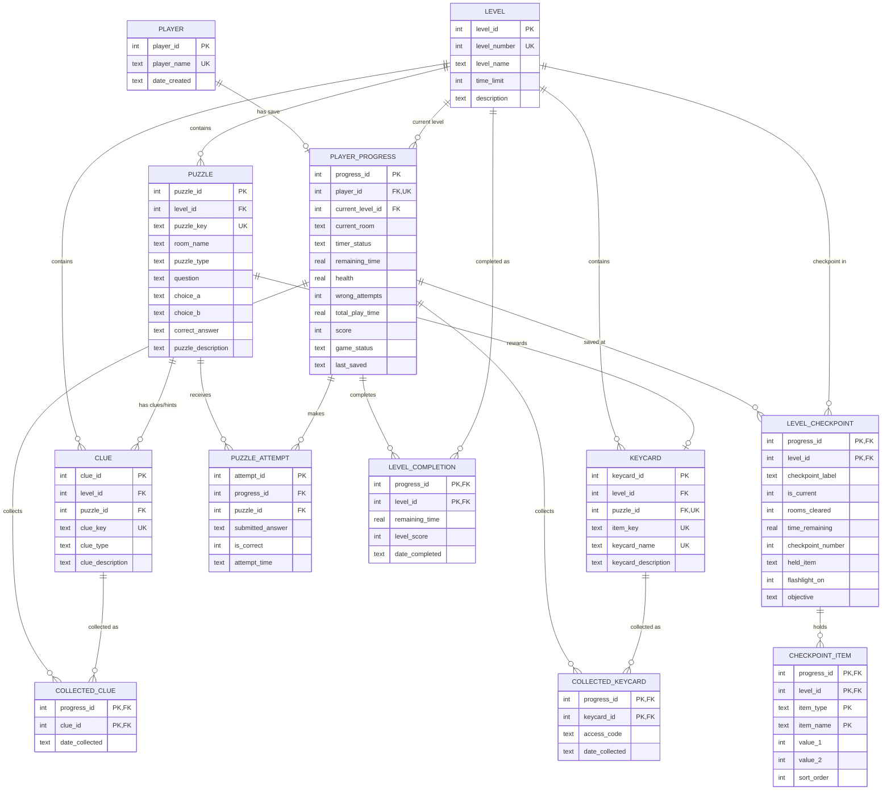

# Code Breaker: A 3D Escape Room Puzzle Game — SQLite Database

This folder holds the master copies and is **outside `Assets/`**, so Unity ignores it. The database is **installed in the game**: §9 lists the copies inside `Assets/`. If you change a script or the SQL here, copy it into `Assets/` again.

| File | What it is |
|---|---|
| `SQL/codebreaker_database.sql` | **The database**: 12 tables, indexes and all game content (levels, puzzles, clues, items, keys, keycards, hints) |
| `SQL/sample_data.sql` | Two example players for testing / the demo |
| `SQL/sample_queries.sql` | Sample SELECT, UPDATE and DELETE statements |
| `codebreaker.db` | The database already built from the script (open it in DB Browser for SQLite) |
| `codebreaker_sample.db` | Same, plus the sample players |
| `UnityScripts/GameDatabase.cs` | Every SQL statement the game uses (plain C#) |
| `UnityScripts/DatabaseManager.cs` | Connects Unity to SQLite and creates the database when the game starts |
| `UnityScripts/DatabaseExamples.cs` | One ready-to-call method per game action (register, save, load, attempts, keycards, next level…) |
| `UnityScripts/SqliteScoreStore.cs` | Plugs the database into the game's existing `IScoreStore` |
| `UnityScripts/SqliteSaveStore.cs` | The game's save (Load Saved Games / Continue, checkpoints) stored in SQLite |
| `UnityScripts/DatabaseHooks.cs` | The one-line calls the game's scripts make when something happens |
| `UnityScripts/Editor/DatabaseViewerWindow.cs` | **Database Viewer** window in Unity: **Code Breaker → Database Viewer** |

### Database Viewer (inside Unity)

Open it from the Unity menu with **Code Breaker → Database Viewer**. It is installed at `Assets/CodeBreaker/Database/Editor/`, an Editor-only script that is not part of the built game.

- **Quick views:** save slot, puzzle attempts (with the question and the correct answer), collected items and hints, keycards (collected or missing), completed levels, checkpoints, checkpoint items. Times are shown in local time.
- **Tables:** all 12 tables with their row counts. Click one to see its rows (up to 500).
- **Click a row** to see its full values at the bottom.
- **Your own query:** type a `SELECT` and press **Run**. Only `SELECT`, `WITH` and `PRAGMA` can run, so the viewer never changes the database.
- **Auto refresh while playing:** keep the window open during Play mode and the view updates every second as you answer, pick up items or save.
- **Open Folder** shows `codebreaker_game.db` in File Explorer.

---

## 1. Database Overview

Code Breaker uses one local **SQLite** file, `codebreaker_game.db`, kept in the player's `Application.persistentDataPath` (`C:\Users\<you>\AppData\LocalLow\DefaultCompany\Code Breaker\`). The game is single-player, so there is no server. The design follows the paper's Data Layer (Figure 7) and requirements REQ009–REQ013 and REQ016–REQ026.

The data comes in two kinds:

- **Game content** (fixed, filled by the script): `level`, `puzzle`, `clue`, `keycard`. It holds everything from the Unity project: the 15 Level 1 lectern questions (`Level 1 Questions.asset`), the 14 Level 2 puzzles and 11 Level 3 puzzles (`PuzzleBook.cs`), and 85 clues: 25 hidden clues, 9 items, 3 keys, 3 access codes and 45 hints taken from `L2Items.cs`, `L2LevelSession.cs` and `L3Manager.cs`.
- **Player data** (written while playing): `player`, `player_progress`, `puzzle_attempt`, `collected_clue`, `collected_keycard`, `level_completion`, `level_checkpoint`, `checkpoint_item`. SQLite is the game's only save: `codebreaker_save.json` is no longer written (§9).

Values taken from the actual game rather than the paper:

| Item | Paper | Game code (used here) |
|---|---|---|
| Database | ERD says MySQL | SQLite (as in the Technical Background) |
| Time limits | Level 1 = 3:00 | 5:00 / 30:00 / 40:00 (`LevelTimer.FixedLimits`) |
| Wrong door | "ends the game" (REQ018) | Trap room takes health; the game ends at 0 health. Both are supported through `game_status = 'GAME_OVER'`. |
| Score | not defined | Seconds left × 10, minus 250 per hint (`L2LevelSession`) |

## 2. Database Tables and Their Purposes

| # | Table | Purpose | Requirement |
|---|---|---|---|
| 1 | `level` | The 3 levels: number, name, time limit, description | REQ014, REQ015 |
| 2 | `player` | Player ID, name, date created | REQ009 |
| 3 | `player_progress` | The save slot: current level and room, timer status, remaining time, health, wrong attempts, total play time, score, game status, last saved | REQ009–REQ011 |
| 4 | `puzzle` | Every question and puzzle with its type, question, correct answer and description; Level 1 rows also have door choices A and B | REQ017–REQ025 |
| 5 | `puzzle_attempt` | Every submitted answer, whether it was correct, and when | REQ012 |
| 6 | `clue` | Hidden clues, items, keys, access codes and hints, each linked to its level and puzzle | REQ019, REQ026 |
| 7 | `collected_clue` | Clues, keys and items the player picked up, plus hints the player opened | Level 2 "save collected clues" |
| 8 | `keycard` | RED (MAINT), BLUE (SEC), GREEN (CTRL), each linked to the side-room challenge that rewards it | REQ022 |
| 9 | `collected_keycard` | Keycards collected in a save, with the code printed on each card that run | REQ013, REQ023 |
| 10 | `level_completion` | Levels finished, with the time left and points earned in each | REQ009, REQ016 |
| 11 | `level_checkpoint` | Where Continue puts the player back inside each level: label, rooms cleared and clock (Level 1), checkpoint number, held item, flashlight, objective (Levels 2–3) | REQ011 |
| 12 | `checkpoint_item` | The Level 2/3 checkpoint state, one row each: inventory item, collected item, flag (puzzle step done), number, door (locked/open), light (on/off) | REQ011 |

**Additions beyond your requested list, and why:**

- `collected_clue` is needed because Level 2 must save collected clues. It also counts hints used, so no separate hint table is needed.
- `level_completion` stores completed levels (REQ009). Keeping each level's score means "Try Again" doesn't count a level twice.
- `player_progress.health` and `game_status` exist because the game has a health bar and must know whether a save is still playable after the trap room, time up, or finishing Level 3.
- `puzzle.room_name`, `choice_a`/`choice_b` and `puzzle_key` hold, respectively, the room each puzzle is in, the two door answers in Level 1, and the game's own puzzle IDs from `PuzzleBook.cs`.
- `keycard.puzzle_id` and `collected_keycard.access_code` record which challenge rewards each card and what value it carries (Level 3 values are random each run).

## 3. Complete SQLite SQL Script

See **`SQL/codebreaker_database.sql`**.

**Where to run it:**

- **To view or check the database (no Unity needed):** in DB Browser for SQLite, choose *New Database*, open the *Execute SQL* tab, paste the script and press ▶. Or just open `codebreaker.db`, which is already built.
- **In the game:** `DatabaseManager.cs` runs the script automatically every time the game starts (see §9).

The script is safe to run any number of times, because `CREATE TABLE IF NOT EXISTS` and `INSERT OR IGNORE` never create duplicates.

Constraints used:

- `PRIMARY KEY AUTOINCREMENT` on every ID.
- Composite keys on `collected_clue`, `collected_keycard` and `level_completion`.
- `NOT NULL` on required columns.
- `UNIQUE` on `player_name` (case-insensitive), `level_number`, `puzzle_key`, `clue_key`, keycard names, and `player_id` in `player_progress` (one save per player, as the "replace saved progress" prompt in the storyboard implies).
- `CHECK` on timer status, game status, puzzle and clue types, `is_correct` (0 or 1), and non-negative time and score.
- `ON DELETE CASCADE` on every child table.
- 12 indexes on foreign-key columns.

## 4. Sample INSERT Statements

See **`SQL/sample_data.sql`**. Run it after the main script on a test copy. It creates:

- **Juan**: finished Levels 1–2 and is in Level 3 with 2 of 3 keycards.
- **Maria**: ran out of time in Level 1.

Short examples:

```sql
INSERT INTO player (player_name) VALUES ('Juan');

INSERT INTO player_progress (player_id, current_level_id, current_room, remaining_time)
VALUES (1, (SELECT level_id FROM level WHERE level_number = 1), 'Room 1', 300);

INSERT INTO puzzle_attempt (progress_id, puzzle_id, submitted_answer, is_correct)
VALUES (1, (SELECT puzzle_id FROM puzzle WHERE puzzle_key = 'Level 1/q05'), 'B', 1);

INSERT INTO collected_keycard (progress_id, keycard_id, access_code)
VALUES (1, (SELECT keycard_id FROM keycard WHERE item_key = 'keycard_red'), 'm = 9');
```

## 5. Sample SELECT, UPDATE and DELETE Statements

See **`SQL/sample_queries.sql`**. It has 12 SELECTs, 5 UPDATEs and 3 DELETEs. Two of the most important:

```sql
-- Has the player collected all three Level 3 keycards? (1 = yes)
SELECT (COUNT(*) = 3) AS has_all_keycards
FROM collected_keycard ck JOIN keycard k ON k.keycard_id = ck.keycard_id
WHERE ck.progress_id = 1 AND k.level_id = (SELECT level_id FROM level WHERE level_number = 3);

-- "Start New Game": delete the old save; CASCADE removes its attempts, clues, keycards, completions
DELETE FROM player_progress WHERE progress_id = 1;
```

## 6. Primary Keys and Foreign Keys Explanation

| Table | Primary key | Foreign keys → parent (on delete) |
|---|---|---|
| level | level_id | — |
| player | player_id | — |
| player_progress | progress_id | player_id → player (CASCADE), current_level_id → level |
| puzzle | puzzle_id | level_id → level (CASCADE) |
| puzzle_attempt | attempt_id | progress_id → player_progress (CASCADE), puzzle_id → puzzle (CASCADE) |
| clue | clue_id | level_id → level (CASCADE), (puzzle_id, level_id) → puzzle (CASCADE) |
| collected_clue | (progress_id, clue_id) | progress_id → player_progress, clue_id → clue (both CASCADE) |
| keycard | keycard_id | level_id → level, (puzzle_id, level_id) → puzzle (both CASCADE) |
| collected_keycard | (progress_id, keycard_id) | progress_id → player_progress, keycard_id → keycard (both CASCADE) |
| level_completion | (progress_id, level_id) | progress_id → player_progress, level_id → level (both CASCADE) |
| level_checkpoint | (progress_id, level_id) | progress_id → player_progress, level_id → level (both CASCADE) |
| checkpoint_item | (progress_id, level_id, item_type, item_name) | (progress_id, level_id) → level_checkpoint (CASCADE) |

- **Composite primary keys** mean the same keycard, clue or level can only be recorded once per save.
- **The `(puzzle_id, level_id)` foreign key** stops a clue or keycard from claiming a different level than its puzzle, so `clue.level_id` can never contradict `puzzle.level_id`.
- **`current_level_id` has no CASCADE on purpose.** A level cannot be deleted while a save is on it.
- **SQLite only enforces foreign keys after `PRAGMA foreign_keys = ON;`.** `GameDatabase` runs it on every connection.

**Normalization (3NF):**

- Every column depends only on its table's key.
- Level names and time limits live only in `level`, and answers only in `puzzle`.
- Hints used and completed challenges are counted from existing rows, not stored twice.
- `player_progress.score` is the required running total. `level_completion.level_score` is the per-level breakdown it is built from.

## 7. Entity Relationship Diagram (ERD)



**Relationships:**

- A player has at most one save (1:0..1).
- A level contains many puzzles, clues and keycards (1:N).
- A puzzle can have many clues and hints, and many attempts.
- Each Level 3 keycard is rewarded by exactly one challenge (gen → RED, s3 → BLUE, c3 → GREEN).
- Saves link to clues, keycards and levels through the three "collected/completed" junction tables (M:N).

**For the paper:** Figures 8–9 show 7 MySQL tables, and `PUZZLE_ATTEMPT` links to `PLAYER`. In this design:

- the database is SQLite, not MySQL
- attempts link to `PLAYER_PROGRESS`, as your requirements specified
- three tables are added: `COLLECTED_CLUE`, `LEVEL_COMPLETION`, and the description columns

You can redraw the figures from the diagram above in Lucidchart.

## 8. Sample Database Records

These are from `codebreaker_sample.db`:

| Table | Example row |
|---|---|
| level | 2, "The Family House", 1800 s |
| puzzle | `Level 1/q03` "Which operator means NOT EQUAL?", A = `==`, B = `!=`, correct **B** |
| puzzle | `Level 2/kitchen_oven` Variable Puzzle, answer **4162** (Flour 4, Sugar 1, Eggs 6, Milk 2) |
| puzzle | `Level 3/term` Code Puzzle, `if (m > s && c != 0) exitCode = m * 10 + s;` → **94** |
| clue | `photo_2`, Hidden Clue, "On the back: channel = 0011 (binary)" |
| keycard | Red Keycard (MAINT), rewarded by `Level 3/gen` |
| player_progress | Juan, Level 3, Control Room, PAUSED, 1520 s, 75 hp, score 12870, IN_PROGRESS |
| puzzle_attempt | Juan, `Level 3/m2`, "class", wrong → then "fanSpeed", correct |
| collected_keycard | Juan, RED "m = 9"; BLUE "s = 4" (GREEN missing → terminal stays locked) |
| level_completion | Juan, Level 1: 152 s left, 1520 pts; Level 2: 1160 s left, 1 hint, 11350 pts |

## 9. Unity C# and SQLite Connection

**Installed (24/11/2026, project `Downloads\CodeBreaker-FInal-Main-main\CodeBreaker-FInal-Main-main`):**

| In `Assets/` | From |
|---|---|
| `Plugins/Mono.Data.Sqlite.dll` | your old OneDrive project (same file Unity 6 ships) |
| `Plugins/x86_64/sqlite3.dll` | your old OneDrive project (SQLite 3.54.1, 64-bit) |
| `CodeBreaker/Database/GameDatabase.cs`, `DatabaseManager.cs`, `DatabaseHooks.cs`, `SqliteScoreStore.cs`, `SqliteSaveStore.cs`, `DatabaseExamples.cs` | `UnityScripts/` |
| `StreamingAssets/CodeBreakerDB/codebreaker_database.sql` | `SQL/` |

**SQLite is the game's save system.** `SaveSystem.cs` (Load / Save / Delete) now reads and writes the database through `SqliteSaveStore.cs`, so **Load Saved Games → Continue**, checkpoints, completed and unlocked levels all come from SQLite, and `codebreaker_save.json` is no longer written:

| Save data | Stored in |
|---|---|
| Level, health, wrong attempts, play time, time saved | `player_progress` |
| Completed levels | `level_completion` |
| Level 1 checkpoint (rooms cleared, clock) | `level_checkpoint` |
| Level 2/3 checkpoint (inventory, flags, numbers, doors, lights, held item, objective) | `level_checkpoint` + `checkpoint_item` |
| Unlocked levels, solved puzzles | not stored, worked out from the rows above on load |

- An existing `codebreaker_save.json` is copied into SQLite once, the first time the game runs, so no progress is lost. The JSON file is left as it was.
- A database made by an older version of the script is upgraded automatically: missing columns are added and nothing is deleted.
- Only if SQLite cannot start (for example, `sqlite3.dll` missing) does `SaveSystem` fall back to the JSON file, so the game can always be played.
- The level scripts did not change: they still work with `SaveData` objects.
- The editor test tools in `CodeBreaker/Editor` and `Level3/Editor` run outside Play mode, where the database is off, so they keep using the JSON file.

**What to do:** press **Play**. The Console should show `[Database] Connected: …/codebreaker_game.db`.

How the connection works:

- `DatabaseManager` starts itself before the first scene, so nothing needs to be placed in a scene.
- It opens `URI=file:<persistentDataPath>/codebreaker_game.db`, turns on foreign keys and runs the SQL script.
- It logs in the last player, or "Player" if there is none.
- It switches the game's existing score system to SQLite (`ScoreStores.Current = new SqliteScoreStore()`). The Level 2 score, time left and completion now go into the database instead of `codebreaker_scores.json`.
- If SQLite fails (for example, a missing DLL), it logs a warning and the game falls back to its JSON save, so play is never blocked.

**Why the file is named `codebreaker_game.db`:** an older build of the game left a `CodeBreaker.db` with an older table layout. Windows file names ignore capital letters, so `codebreaker.db` would open such a file.

**What saves automatically.** The game's scripts call `DatabaseHooks.cs`. Each call is one line marked `// SQLite`:

| Game script (line added) | Hook | What goes into the database |
|---|---|---|
| `MainMenuController.BeginNewGame`, `GameFlowManager.StartNewGame` | `NewGame` | Old save slot replaced by a new one (cascade) |
| `GameFlowManager.BeginLevelBookkeeping` | `LevelStarted` | Current level, first room, timer, health; status IN_PROGRESS |
| `RoomManager.OnDoorChosen`, `RoomManager.OnThresholdCrossed` | `Level1DoorChosen` | `puzzle_attempt` (question q01–q15, door A/B, correct or not); room, timer, health |
| `GameFlowManager.LevelCompleted` | `LevelCompleted` | Level 1 → `level_completion`, score, save moves to Level 2 |
| `L2LevelSession.FinishLevel` (already existed) | `SqliteScoreStore` | Level 2 → `level_completion`, score, save moves to Level 3 |
| `L2Game.SetFlag`, `L2Game.AssemblePhoto` | `Level2Flag` | `puzzle_attempt` for every Level 2 puzzle when it is solved (photo, star lamp, star slot, UV mirror, stars, exits …) |
| `L2Oven.Submit`, `L2RecipeCard.Pick`, `L2UI` moon box lock, `L2Workstation` checks + password | `Level2Answer` | `puzzle_attempt` with what was typed or chosen, right **and** wrong (e.g. oven `4126` wrong, `4162` correct) |
| `L2Game.Collect` | `ItemCollected` | Level 2 clues/keys/items, Level 3 tags/fuses → `collected_clue`; RED/BLUE/GREEN → `collected_keycard` with this run's code (`m = 9` …) |
| `L3Keypad.Submit` | `Level3Input` | Remembers what was typed |
| `L3Manager.Solve`, `L3Manager.AddWrong` | `Level3Result` | `puzzle_attempt` for every Level 3 challenge (m1 … term); the terminal logs whether all 3 keycards are collected |
| `L2Game.CompleteLevel` | `LevelCompleted` | Level 3 → `level_completion`, score, status COMPLETED |
| `GameFlowManager.GameOver` | `GameOver` | Status GAME_OVER (TIME_UP when time ran out) |

**Not saved:**

- The Level 3 fan dial (it has no station).
- Wrong tries on Level 2 puzzles that have no typed answer (e.g. using the wrong item on the star slot). The solve itself is saved.
- Level 2's own time-up screen (Retry / Quit), which doesn't go through `GameOver`.

`DatabaseExamples.cs` shows how to add any of these.

```csharp
if (DatabaseManager.IsReady)
{
    GameDatabase db = DatabaseManager.Instance.Db;
    int save = DatabaseManager.Instance.CurrentProgressId;
    db.RecordAttempt(save, "Level 3/s3", "42", true);
}
```

## 10. Save and Load Game Progress Implementation

Each call is one line, taken from `DatabaseExamples.cs`:

| Task | Call | Where in the game |
|---|---|---|
| Register / create player | `DatabaseExamples.RegisterPlayer("Juan")` | Name field on the main menu |
| New game | `DatabaseExamples.StartNewGame()` | Start New Game → Start Over |
| Save level, room, timer, health | `DatabaseExamples.SaveProgress("Kitchen")` | Checkpoints, puzzle solved, pause, quit |
| Save only the timer | `DatabaseExamples.SaveTimer(paused: true)` | Pause menu |
| Load saved progress | `DatabaseExamples.ContinueSavedGame()` | Load Saved Games → Continue (restores timer and health) |
| Record Level 1 door | `DatabaseExamples.OnLevel1DoorChosen(questionIndex, AnswerLetter.B)` | Door trigger |
| Record any attempt | `DatabaseExamples.RecordAttempt("Level 2/kitchen_oven", input, ok)` | Keypads, locks, terminals |
| Save a collected clue | `DatabaseExamples.OnItemCollected("photo_1")` | Item pickup |
| Use a hint | `DatabaseExamples.OnHintUsed("Level 2/kitchen_oven", 1)` | Hint button |
| Update score | `DatabaseExamples.SetScore(n)` / `CurrentScore()` | HUD |
| Save a keycard | `DatabaseExamples.OnKeycardCollected("keycard_red", "m = 9")` | Keycard pickup |
| Check all 3 keycards | `DatabaseExamples.OnTerminalSubmit(code, ok)` → `db.HasAllLevel3Keycards()` | Central terminal |
| Level done → next level | `DatabaseExamples.OnLevelCompleted(2, loadNextNow: true)` | Next Level button |
| Game over | `DatabaseExamples.OnGameOver(timeUp: true)` | `GameFlowManager.TimeUp()` / `PlayerDied()` |

`OnLevelCompleted` does three things:

- It saves the level's time left and score (seconds × 10 − Level 2 hints × 250).
- It moves the save to the next level's first room with a full timer.
- It loads that level through your `SceneLoader`, so the loading screen still shows. After Level 3 it marks the game COMPLETED and returns to the main menu.

## 11. Testing and Validation

**Already tested** (results from an automated test of 52 checks, all passed):

- **Compile check:** the 4 scripts compiled with Unity 6000.5.10f1's own C# 9 compiler against this project's `Assembly-CSharp.dll`, the .NET Standard 2.1 references and `Mono.Data.Sqlite.dll`, with 0 errors and 0 warnings.
- **Script:**
  - creates exactly 10 tables and 11 indexes
  - running it twice adds no duplicates
  - content counts are right (3 levels, 15 + 14 + 11 puzzles, 3 keycards, 85 clues)
  - `PRAGMA integrity_check` and `foreign_key_check` are clean
- **`sample_data.sql`** loads, and all 20 statements in `sample_queries.sql` run end to end.
- **Full playthrough through `GameDatabase`:**
  - register a player, start a game, save and load
  - Level 1 door check and attempt, then complete Level 1 (moves to Level 2 with 1800 s)
  - clues and a hint, Level 2 score 11350
  - Try Again doesn't double the score
  - 2 of 3 keycards keeps the terminal locked; 3 of 3 unlocks it
  - Level 3 completion → COMPLETED
  - Start New Game cascades the old data away
  - time up → GAME_OVER
- **Constraints reject bad data:**
  - invalid timer status, negative time, `is_correct = 2`
  - an attempt for a missing save, a second save for one player, a duplicate name in any capitalization
  - a duplicate keycard, a clue on the wrong level, Level 4, a question with only one door
- **SQL injection:** an answer containing `'); DROP TABLE player; --` is stored as plain text, because all values use `@parameters`.

After installing, the same 52 checks were run again with the project's own `Assets/Plugins/x86_64/sqlite3.dll` (3.54.1): all passed. The `Assets/` copies of the scripts also compile with 0 errors and 0 warnings.

After the hooks were added:

- The whole game assembly (136 scripts, including the 7 edited game scripts) compiled with Unity's compiler with 0 errors.
- The 10 Level 3 station names in `Level 3.unity` (m1 … term) all exist as puzzles in the database.
- A replay of one full playthrough, using the exact calls the hooks make, passed 7 of 7 checks:
  - Level 1 doors, then completion
  - Level 2 items and score
  - all 10 Level 3 stations and the 3 keycards (terminal locked at 2, open at 3)
  - Level 3 completion counted once even when it fires twice
  - new game after a game over

After moving the save system to SQLite (new project, 24/11/2026):

- The game assembly (137 scripts) and the editor assembly (35 scripts) both compiled with Unity's compiler with 0 errors. `SaveSystem.cs` keeps the same public methods, so the editor tools still compile.
- Save tests passed 21 of 21 with the project's `sqlite3.dll`:
  - a fresh database has 12 tables
  - **your real old `codebreaker_game.db` was upgraded** (copy) with its Level 3 save, score 9130 and attempts kept
  - save slot values come back, and the room is kept within a level
  - Level 1 and Level 2 checkpoints come back with every value and in the same item order
  - replacing checkpoints removes the old rows
  - a completed level is never counted twice
  - deleting a save removes its checkpoints and items (cascade)
  - the new tables reject bad data (missing save, unknown item type, negative wrong attempts)
- The earlier suites still pass: 7 of 7 for the hook flow, and 50 of 52 for the database. The 2 differences are the expected new counts: 12 tables and 12 indexes instead of 10 and 11.

**Not tested yet.** These need the Unity Editor in Play mode:

- Load Saved Games → Continue putting you back at a Level 2/3 checkpoint from SQLite
- the one-time copy of the old JSON save
- the hooks firing inside the real scenes of the new project

Dates are stored in UTC (`datetime('now')`), because Windows' built-in SQLite has no local-time support. They are shown in local time via `SaveGame.LastSavedLocal`.

**Manual test checklist in Unity:**

1. Play → Console shows `Connected`.
2. Choose a wrong door, then a right door → `puzzle_attempt` has a 0 row and a 1 row.
3. Pick up `photo_1` → a row appears in `collected_clue`.
4. Collect 2 keycards → the terminal says ACCESS DENIED; collect the 3rd → it accepts the code.
5. Finish a level → a `level_completion` row appears, the score goes up, and the next scene loads.
6. Quit, Play, Load Saved Games → you return to the same level, room and timer.

To inspect the data:

```powershell
C:\sqlite\sqlite3.exe "$env:USERPROFILE\AppData\LocalLow\DefaultCompany\Code Breaker\codebreaker_game.db"
```
